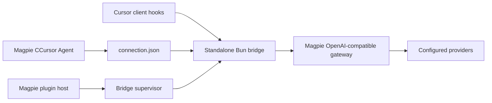

# Architecture

This adaptation routes **Cursor → CCursor → Magpie**, preserving CCursor's BYOK direction.

## Magpie boundaries

- `agent.mjs` exports `agent` and `connect`. The Agent has no `model` field: Cursor chooses from the full `models` list supplied by Magpie. Magpie writes and restores `~/.magpie-ccursor/connection.json`. The top-level `apiKey` string lets Magpie track connection ownership; an initially empty model list is allowed.
- `index.ts` exports one OpenCode v1 plugin function. Its `config` hook starts a supervisor; it does not register a model provider or make Cursor patches.
- `src/supervisor.ts` starts a dedicated Bun child with its own stdin pipe, forwards diagnostic stderr, and restarts unexpected exits with bounded backoff. Parent exit closes the pipe.
- `src/daemon.ts` owns the standalone process and a PID lock, observes connection changes, writes derived providers, and runs the protocol server only while connected. An absent or malformed connection stops the server. No gateway request is made merely by connecting.
- `page/` uses the official `_magpie/bridge.js`. It displays setup instructions and requests no privileged read permissions.

Magpie's documented mixed Agent/server entry support is checked against `internal/plugin/agent.go` and `internal/plugin/host.js`. Its `internal/agent/plugged.go` writes each `connect` key using `edit.KV`, stashes prior values, and restores/deletes them on disconnect.

## Runtime

`src/runtime.ts` adapts the newly downloaded CCursor server. The protocol schemas, service registrations, orchestrator and LLM conversion remain in `vendor/server`.

The runtime uses `bun:sqlite` behind the existing async database interface. A queue and `AsyncLocalStorage` keep a transaction's operations together across awaits. Paths are set explicitly before stores initialize; `BYOK_AGENT_DB_PATH` cannot redirect the database to old installation data.

Only `127.0.0.1` is bound. Provider changes clear SDK clients and push model-refresh events. Shutdown stops file watchers, closes event streams and sessions, clears caches and closes the database. The daemon gives shutdown a four-second process deadline.

## State and credentials

`connection.json` is Magpie-owned. `providers.json` is derived; it contains only the Magpie gateway key and assigned model metadata. The standalone server never reads `~/.ccursor` or dynamically loads code from an installed Cursor application. Conversation storage and runtime logs stay below `~/.magpie-ccursor`.

The retained Cursor patch code may inspect a Cursor application only when the user explicitly runs `status`, `setup`, or `restore`. Existing hooks can connect on the upstream default port; new hooks use the separate data directory. The original installer entry points remain vendored for provenance, but the plugin CLI does not execute their extension installer, uninstall routine or defaults-release routine.

## Patches

`src/setup.ts` wraps selected upstream patch functions in an additional snapshot transaction. The complete pre-edit files and hashes are retained. Restore tolerates already-restored files and refuses unrelated changes. It does not remove the original CCursor extension or use its existing backups.

## Sources

- [Magpie plugin guide](https://usemagpie.ai/docs/zh/plugins)
- [CCursor source baseline](https://github.com/CometixSpace/CCursor/tree/fcac85db793fc2c8cda3318b96ec5a41c24f5e26)
- [Magpie plugin host](https://github.com/yetone/magpie/blob/main/internal/plugin/host.js)
- [Magpie Agent configuration writer](https://github.com/yetone/magpie/blob/main/internal/agent/plugged.go)
