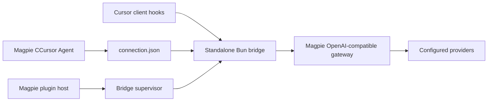

# Architecture

This adaptation routes **Cursor → CCursor → Magpie**, preserving CCursor's BYOK direction.

## Magpie boundaries

- `agent.mjs` exports `agent` and `connect`. The Agent has no `model` field: Cursor chooses from the full `models` list supplied by Magpie. Magpie writes and restores `~/.magpie-ccursor/connection.json`. The top-level `apiKey` string lets Magpie track connection ownership; an initially empty model list is allowed.
- `index.ts` exports one OpenCode v1 plugin function. Its `config` hook starts a supervisor. Automatic client setup runs in the supervised daemon rather than an install script.
- `src/supervisor.ts` starts a dedicated Bun child with its own stdin pipe, forwards diagnostic stderr, and restarts unexpected exits with bounded backoff. Parent exit closes the pipe.
- `src/daemon.ts` owns the standalone process and a PID lock. After acquiring the lock, it checks and installs Cursor hooks even before the Agent is connected. It observes connection changes, writes derived providers, and runs the protocol server only while connected. An absent or malformed connection stops the server. No gateway request is made merely by connecting.
- The package registers the Agent and server entry only. Connection and model assignment use Magpie's **Agent → CCursor** controls; no plugin page is registered.

Magpie's documented mixed Agent/server entry support is checked against `internal/plugin/agent.go` and `internal/plugin/host.js`. Its `internal/agent/plugged.go` writes each `connect` key using `edit.KV`, stashes prior values, and restores/deletes them on disconnect.

## Runtime

`src/runtime.ts` adapts the newly downloaded CCursor server. The protocol schemas, service registrations, orchestrator and LLM conversion remain in `vendor/server`.

The runtime uses `bun:sqlite` behind the existing async database interface. A queue and `AsyncLocalStorage` keep a transaction's operations together across awaits. Paths are set explicitly before stores initialize; `BYOK_AGENT_DB_PATH` cannot redirect the database to old installation data.

Only `127.0.0.1` is bound. Provider changes clear SDK clients and push model-refresh events. Shutdown stops file watchers, closes event streams and sessions, clears caches and closes the database. The daemon gives shutdown a four-second process deadline.

## State and credentials

`connection.json` is Magpie-owned. `providers.json` is derived; it contains only the Magpie gateway key and assigned model metadata. The standalone server never reads `~/.ccursor` or dynamically loads code from an installed Cursor application. Conversation storage and runtime logs stay below `~/.magpie-ccursor`.

The daemon inspects the local Cursor application for automatic setup and update recovery. The CLI also exposes `status`, `setup`, and `restore`. Existing complete hooks can connect on the upstream default port; new hooks use the separate data directory. Only the upstream installer modules used by the plugin are retained; the original extension installer, uninstall routine and defaults-release routine are not included.

## Patches

`src/setup.ts` wraps selected upstream patch functions in an additional snapshot transaction. The complete pre-edit files and hashes are retained, including independent Agent Host network chunks. Restore tolerates already-restored files and refuses unrelated changes. It does not remove the original CCursor extension or use its existing backups.

Cursor 3.26 uses a local inference loop by default for some accounts. Its `RunInferenceClientMessage` is not the `AgentClientMessage` consumed by this bridge. The renderer patch makes `readLocalLoopGate()` return false while BYOK is enabled, keeping the Agent Host but selecting its existing Connect/RunSSE path. Turning BYOK off restores the official gate result. The existing routes SSE connection updates this choice. Recorded older plugin hooks can be upgraded while retaining the original clean-file backups; unknown or modified files are refused.

Model catalog synchronization tracks captured AiService instances by their reactive storage. While BYOK is active, it requests the parsed model catalog through the client's existing transport and requires the bridge's `x-magpie-ccursor-catalog` response header before adopting it. Models, picker display configuration and feature defaults form one snapshot; reactive change notifications repair stale window snapshots without modifying credentials or model enable/disable preferences. OFF and disconnect invalidate pending replies, dispose observers, restore the previous catalog (including the own-key cache when enabled), and resume native refresh. The synchronizer reuses the existing SSE connection. `globalThis.__magpieCatalogSync.status()` reports only state and model counts for diagnosis.

Cursor's placeholder IDs `default`, `auto`, and an empty model choice map to the same explicitly enabled assigned default used by `GetDefaultModel` and feature defaults. Magpie emits `defaultOn: true` for each assigned model. A registered exact ID takes precedence over alias interpretation; disabled or missing default candidates are never used as an implicit fallback. Other unknown IDs still fail with instructions for Magpie → Agent → CCursor.

Automatic setup is independent of Agent connection state and is idempotent for a fully patched installation. Setup and restore use a kernel-held loopback port guard derived from the canonical data directory, followed by the legacy `patch.lock` for compatibility with older writers. The OS releases the guard when the process exits. Only a well-formed owner record whose PID probe returns `ESRCH` can be archived; an old writer winning file-lock acquisition is never overwritten. The complete owner record is published through an exclusive hard link. A port collision or live/unknown owner produces `waiting` and is retried without requiring target changes. Unsupported hard-link filesystems fail closed.

A same-version interrupted setup is recovered only under both locks, with a matching application root, package hash, complete unique target set, valid backups, every live target matching its original hash, no existing hooks, and the required desktop/extension-host checksums. All available product checksums for targets are checked; real Cursor 3.27 does not provide a Glass checksum, so its unchanged bytes are verified against the same-version snapshot. Recovery archives the interrupted manifest and changes metadata only before normal setup takes a fresh snapshot. Partial writes, interrupted plugin-hook upgrades, and cross-version interrupted snapshots remain blocked. This handles process termination, not power-loss durability.

A clean newer Cursor version gets its own snapshot; prior backups remain available. If the package version changes during patching, rollback is skipped to avoid copying old files over the updater's files. Manual restore records `restoring` before the first target copy and pauses automatic setup across crashes. Automatic setup rechecks that intent inside its critical section; only explicit setup after a completed restore enables it again. Patching never closes Cursor: an already-running client must be restarted to load the hooks. Status is reported in `auto-setup.json` and logs without stopping the model bridge.

## Upstream 0.0.16 integration

The synchronized snapshot is `c110c6e8ae34f785bca453c163bc113993f19b70`, whose extension and installer both declare `0.0.16`. There is no matching release tag. Four generated protobuf modules now match Cursor 3.27.22; shared enum imports and removed service handlers follow the new descriptors.

Agent Window renderer hook rev2 routes advertised unary and server-streaming Connect RPCs to the loopback bridge. REST and RPC rules arrive over the same SSE connection. Unsupported client/bidirectional streaming kinds keep their original transport; an already-consumed stream is never replayed. The local stream decoder validates framing and terminal metadata, rejects premature EOF, and releases its response reader.

Node HTTP/1.1 router V3 reloads route metadata before a request is routed and exposes a process-local predicate. The Agent Host turn guard checks that predicate before allowing the managed-local inference branch. BYOK routes use Connect, and disabling BYOK preserves the official branch. ServerConfig explicitly disables HTTP/2 while locally routed.

BYOK mode writes accept an idempotent target value; legacy toggle requests are debounced. The Magpie adaptation serializes the complete read/decide/write operation and resets debounce state between runtime instances. Mode changes push REST/RPC rules, a debounced refresh, and one later refresh to replace an in-flight official model response. Both timers are cancelled when the runtime stops.

A recorded, hash-matching old plugin installation can upgrade renderer, always-local and Agent Host patches in one snapshot transaction. This differs from upstream's uninstall-first requirement and retains the pristine backup across upgrades. Unrecorded changes remain blocked; no foreign file is silently accepted as a new baseline.

## Optional Chinese interface

`magpie.panels` registers one `agents` panel and no sidebar page. The panel uses only its own `magpie.options` bridge calls; after a successful write it reloads itself. Serving that hosted panel invokes Magpie's `pageHost/Warm`, which is necessary because `SetOptions/Restart` alone retires the old host and starts a new one only on demand.

The plugin config hook writes the effective `localize` boolean to a separate `plugin-options.json`; it never changes Agent connection credentials. The daemon reads it each tick. Preference changes bypass the normal inspection interval but retain file-settlement and patch-lock checks. An explicit manual restore remains paused.

Localization uses a version-and-hash catalog with three known clean states: English, legacy localized, and localized with known protocol/export identifiers retained. It preflights both immutable renderer backups, produces buffers with UTF-8 byte edits, verifies output hashes, and runs the ordinary installer in the existing snapshot transaction. Toggle upgrades retain original backups; full restore always returns the first recorded baseline. Unknown builds return `unsupported` without guessing replacements. No-op confirmation additionally verifies the full applied target set and hashes.

The VS Code language pack and language settings are outside this option's ownership. See [localization notes](localization.md) for user-visible behavior.

## Sources

- [Magpie plugin guide](https://usemagpie.ai/docs/zh/plugins)
- [CCursor source baseline](https://github.com/CometixSpace/CCursor/tree/c110c6e8ae34f785bca453c163bc113993f19b70)
- [Magpie plugin host](https://github.com/yetone/magpie/blob/main/internal/plugin/host.js)
- [Magpie Agent configuration writer](https://github.com/yetone/magpie/blob/main/internal/agent/plugged.go)
