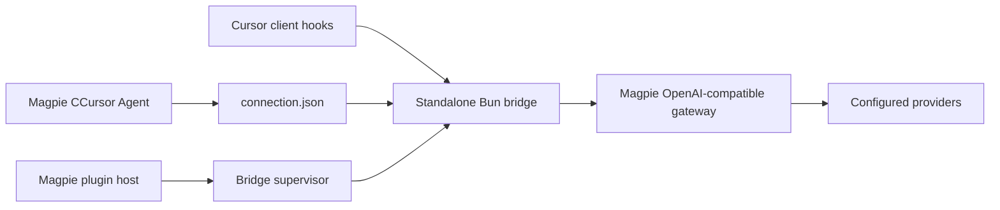

# Architecture

This adaptation routes **Cursor → CCursor → Magpie**, preserving CCursor's BYOK direction.

## Magpie boundaries

- `agent.mjs` exports `agent` and `connect`. The Agent has no `model` field: Cursor chooses from the full `models` list supplied by Magpie. Magpie writes and restores `~/.magpie-ccursor/connection.json`. The top-level `apiKey` string lets Magpie track connection ownership; an initially empty model list is allowed.
- `index.ts` exports one OpenCode v1 plugin function. Its `config` hook starts a supervisor. Automatic client setup runs in the supervised daemon rather than an install script.
- `src/supervisor.ts` starts a dedicated Bun child with its own stdin pipe, forwards diagnostic stderr, and restarts unexpected exits with bounded backoff. Parent exit closes the pipe.
- `src/daemon.ts` owns the standalone process and a PID lock. After acquiring the lock, it checks and installs Cursor hooks even before the Agent is connected. It observes connection changes, writes derived providers, and runs the protocol server only while connected. An absent or malformed connection stops the server. No gateway request is made merely by connecting.
- `page/` uses the official `_magpie/bridge.js`. It displays setup instructions and requests no privileged read permissions.

Magpie's documented mixed Agent/server entry support is checked against `internal/plugin/agent.go` and `internal/plugin/host.js`. Its `internal/agent/plugged.go` writes each `connect` key using `edit.KV`, stashes prior values, and restores/deletes them on disconnect.

## Runtime

`src/runtime.ts` adapts the newly downloaded CCursor server. The protocol schemas, service registrations, orchestrator and LLM conversion remain in `vendor/server`.

The runtime uses `bun:sqlite` behind the existing async database interface. A queue and `AsyncLocalStorage` keep a transaction's operations together across awaits. Paths are set explicitly before stores initialize; `BYOK_AGENT_DB_PATH` cannot redirect the database to old installation data.

Only `127.0.0.1` is bound. Provider changes clear SDK clients and push model-refresh events. Shutdown stops file watchers, closes event streams and sessions, clears caches and closes the database. The daemon gives shutdown a four-second process deadline.

## State and credentials

`connection.json` is Magpie-owned. `providers.json` is derived; it contains only the Magpie gateway key and assigned model metadata. The standalone server never reads `~/.ccursor` or dynamically loads code from an installed Cursor application. Conversation storage and runtime logs stay below `~/.magpie-ccursor`.

The daemon inspects the local Cursor application for automatic setup and update recovery. The CLI also exposes `status`, `setup`, and `restore`. Existing complete hooks can connect on the upstream default port; new hooks use the separate data directory. The original installer entry points remain vendored for provenance, but the plugin does not execute their extension installer, uninstall routine or defaults-release routine.

## Patches

`src/setup.ts` wraps selected upstream patch functions in an additional snapshot transaction. The complete pre-edit files and hashes are retained, including independent Agent Host network chunks. Restore tolerates already-restored files and refuses unrelated changes. It does not remove the original CCursor extension or use its existing backups.

Cursor 3.26 uses a local inference loop by default for some accounts. Its `RunInferenceClientMessage` is not the `AgentClientMessage` consumed by this bridge. The renderer patch makes `readLocalLoopGate()` return false while BYOK is enabled, keeping the Agent Host but selecting its existing Connect/RunSSE path. Turning BYOK off restores the official gate result. The existing routes SSE connection updates this choice. Recorded older plugin hooks can be upgraded while retaining the original clean-file backups; unknown or modified files are refused.

Model catalog synchronization tracks captured AiService instances by their reactive storage. While BYOK is active, it requests the parsed model catalog through the client's existing transport and requires the bridge's `x-magpie-ccursor-catalog` response header before adopting it. Models, picker display configuration and feature defaults form one snapshot; reactive change notifications repair stale window snapshots without modifying credentials or model enable/disable preferences. OFF and disconnect invalidate pending replies, dispose observers, restore the previous catalog (including the own-key cache when enabled), and resume native refresh. The synchronizer reuses the existing SSE connection. `globalThis.__magpieCatalogSync.status()` reports only state and model counts for diagnosis.

Cursor's reserved Auto ID `default` maps to the same assigned default used by `GetDefaultModel` and feature defaults. An explicitly assigned ID takes precedence, and all other unknown IDs still fail with instructions for Magpie → Agent → CCursor.

Automatic setup is independent of Agent connection state and is idempotent for a fully patched installation. Setup and restore share an exclusive `patch.lock`; an abandoned lock needs review rather than automatic deletion. A clean newer Cursor version gets its own snapshot; prior backups remain available. Unknown partial hooks and interrupted snapshots are not overwritten automatically. If the package version changes during patching, rollback is skipped to avoid copying old files over the updater's files. Manual restore pauses automatic setup until a subsequent manual setup. Patching changes files on disk and never closes Cursor: an already-running client must be restarted once to load the hooks. Errors are reported in `auto-setup.json` and logs without stopping the model bridge.

## Sources

- [Magpie plugin guide](https://usemagpie.ai/docs/zh/plugins)
- [CCursor source baseline](https://github.com/CometixSpace/CCursor/tree/fcac85db793fc2c8cda3318b96ec5a41c24f5e26)
- [Magpie plugin host](https://github.com/yetone/magpie/blob/main/internal/plugin/host.js)
- [Magpie Agent configuration writer](https://github.com/yetone/magpie/blob/main/internal/agent/plugged.go)
